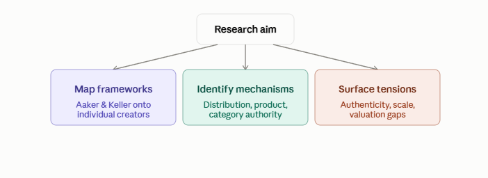
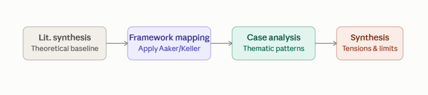

# From Influencers to Digital Creators-as-Brands

**Building Sustainable Brand Equity in the Creator Economy**

Ifshita · MBA in Digital Marketing Management · September 2026

## Abstract

The creator economy has evolved rapidly over the past decade, shifting from a novelty adjacent to traditional media into a multi-billion-dollar sector that reshapes culture, commerce, and communication. Early digital creators built careers on the "influencer" model — converting platform-based attention into sponsorship revenue — a structurally fragile arrangement dependent on borrowed audiences, opaque algorithms, and the goodwill of platforms that can change the rules without warning. This paper examines the emergence of an alternative archetype: the creator as brand-builder, who treats an audience not as rented inventory but as the foundation of an owned, durable business. Using established brand equity theory — principally Aaker's (1991) and Keller's (1993) frameworks — as an analytical lens, this study investigates how individual digital creators convert ephemeral attention into sustainable brand equity.

The paper pursues three objectives: mapping traditional brand equity pillars (awareness, perceived quality, associations, and loyalty) onto the individual creator context; identifying the specific mechanisms through which creators build durable equity, including diversified distribution, productized point-of-view, persona-brand separation, and category authority; and surfacing the structural tensions that complicate this transition, notably the authenticity-scale trade-off and the immaturity of creator valuation methods. Given the emergent and unevenly documented nature of this phenomenon, the study adopts a qualitative, conceptual research design, proceeding through literature synthesis, framework mapping, thematic case analysis, and critical synthesis rather than statistical or survey-based methods.

Findings indicate that attention and brand equity are distinct constructs: reach corresponds only to the awareness pillar, while sustainable value requires dimensions platforms neither measure well nor incentivize. The transition from influencer to brand is shown to be mechanism-driven rather than scale-driven, with productization emerging as the pivotal moment at which a creator's taste becomes an asset independent of continued personal output. The authenticity-scale tension persists even among successful creators, and the absence of standardized valuation methods remains a structural bottleneck for licensing and investment in this space. The paper concludes that the creator economy is undergoing a genuine maturation process analogous to that of twentieth-century consumer brands, compressed into a shorter timeframe and complicated by platform dependencies legacy brands never faced — and calls for further longitudinal and empirical research to validate and extend the conceptual framework proposed here.

Keywords: creator economy, brand equity, influencer marketing, digital creators, brand-building, personal branding

## Chapter 1: Introduction

Introduction

### 1.1 The Changing Landscape of Digital Fame

Over the past decade, the creator economy has evolved from a novelty adjacent to traditional media into a multi-billion-dollar sector reshaping how culture, commerce, and communication intersect. Early digital creators — the first wave of "influencers" — built careers by accumulating attention on emerging platforms and converting that attention into sponsorship revenue. This model, while lucrative for a time, was structurally fragile: it depended entirely on borrowed audiences, opaque algorithms, and the goodwill of platforms that could change the rules overnight. As the market has matured, a new archetype has emerged — the creator as brand-builder, someone who treats their audience not as rented inventory but as the foundation of an owned, durable business.

### 1.2 The Problem of Fragile Value

The central tension explored in this paper is one of sustainability. Influencer income, by design, is lumpy and precarious: tied to campaign cycles, subject to algorithmic whim, and non-transferable across platforms. A creator with millions of followers on one app owns none of that relationship in any legal or economic sense. This creates a paradox at the heart of the creator economy — enormous cultural influence coexisting with minimal enterprise value. Brands, by contrast, accumulate equity that compounds over time: recognizable identity, consumer trust, and cash flows that persist independent of any single post or platform. The shift from influencer to creator-as-brand is, in essence, an attempt to resolve this paradox by importing the logic of traditional brand-building into a space that has historically operated on attention arbitrage alone.

### 1.3 Purpose and Structure of This Paper

This paper argues that the creator economy is undergoing a maturation process analogous to the one traditional consumer brands experienced across the twentieth century — but compressed into a fraction of the time, and complicated by a degree of platform dependency that legacy brands never had to navigate. Drawing on established frameworks of brand equity (notably Aaker's and Keller's models), this paper examines how individual creators can translate ephemeral attention into durable, ownable assets. The analysis proceeds in three parts: first, a conceptual mapping of traditional brand equity pillars onto the creator context; second, an examination of the specific mechanics — diversified distribution, productized point-of-view, and category authority — through which creators build lasting equity; and third, a discussion of the structural tensions that complicate this transition, including the trade-off between authenticity and scale, and the immaturity of valuation methods for creator-owned assets. Together, these sections aim to offer both a theoretical framework and a practical lens for understanding where the creator economy is headed.

## Chapter 2: Review Of Literature

2. Review of Literature

### 2.1 Foundations of Brand Equity Theory

The theoretical backbone for this paper draws on two canonical models of brand equity. Aaker (1991) conceptualizes brand equity as a composite of brand loyalty, awareness, perceived quality, and brand associations, arguing that value accrues not from a single asset but from the interaction of these dimensions over time. Keller's (1993) Customer-Based Brand Equity model complements this by emphasizing brand knowledge — the structure of associations held in the consumer's mind — as the true site of equity creation. Both frameworks share a critical premise: equity is relational and cumulative, built through repeated, consistent interactions rather than single transactions. This premise underlies the paper's central argument that influencer marketing, as traditionally practiced, generates attention without necessarily generating equity, since individual sponsored posts rarely accumulate into the kind of structured brand knowledge these models describe.

### 2.2 The Influencer Economy as a Media-Buying Model

A separate body of literature treats influencers primarily as a media channel rather than as brand entities in their own right. Scholars studying influencer marketing (e.g., De Veirman, Cauberghe, & Hudders, 2017; Abidin, 2016) frame the creator's value proposition in terms of reach, engagement, and perceived authenticity — metrics that are inherently platform-dependent and transactional. This research documents the volatility of influencer income and the precarity created by algorithmic dependency, but generally stops short of examining how creators might convert audience attention into ownable, non-platform assets. The literature here is useful for establishing the fragility this paper seeks to address, but it offers limited theoretical tools for understanding the transition toward brand-like durability.

### 2.3 Emerging Work on Creator Entrepreneurship

A more recent and still-developing strand of scholarship examines creators as entrepreneurs and small-business owners rather than pure media personalities. Work in this vein (e.g., Duffy, 2017; Cunningham & Craig, 2021) explores how creators diversify revenue through merchandise, subscriptions, and direct audience monetization, and highlights the labor and emotional costs of maintaining an authentic persona at commercial scale. This literature begins to bridge the gap between influencer studies and brand theory but rarely applies formal brand equity frameworks directly to individual creators, leaving an analytical gap this paper aims to address.

### 2.4 Gaps in the Existing Literature

Taken together, the literature reveals a disconnect: brand equity theory offers robust frameworks for understanding durable value creation but was developed for corporate entities, not individuals; influencer studies document the mechanics and precarity of platform-based fame but lack a rigorous equity framework; and creator entrepreneurship research gestures toward brand-building without systematically applying established models. This paper positions itself at the intersection of these three literatures, using brand equity theory as an analytical lens through which to examine the specific strategies by which creators move from rented attention to owned equity.

## Chapter 3: Research Objectives And Methodology

3. Research Objectives and Methodology

### 3.1 Research Objectives

This paper is guided by three interrelated objectives. First, to map established brand equity frameworks — principally Aaker's and Keller's models — onto the individual creator context, identifying which dimensions translate directly and which require adaptation. Second, to identify and categorize the specific mechanisms through which digital creators convert platform-dependent attention into durable, ownable brand equity, drawing on observable practices such as distribution diversification, productization, and category authority-building. Third, to surface the structural tensions and limitations that complicate this transition — including the authenticity-scale trade-off and the absence of standardized valuation methods — in order to offer a realistic, rather than purely aspirational, account of the shift from influencer to creator-as-brand.

### 3.2 Research Design and Methodology

This paper adopts a qualitative, conceptual research design rather than an empirical or statistical one. It proceeds through four stages: a synthesis of existing brand equity and influencer-economy literature (establishing the theoretical baseline); a framework-mapping exercise applying Aaker's and Keller's brand equity pillars to the creator context; a thematic analysis of illustrative case examples (e.g., creators who have successfully productized their point of view) to identify recurring equity-building mechanisms; and a critical synthesis stage that surfaces the tensions and limitations of this transition. This design was chosen because the phenomenon under study — the maturation of individual digital identities into brand assets — is still emergent and unevenly documented, making a conceptual, literature-and-case-driven approach more appropriate than a survey or econometric method at this stage of the field's development.

## Chapter 4: Data Analysis And Interpretation

4. Data Analysis and Interpretation

Because this study is conceptual rather than empirical, "data" here refers to the qualitative evidence drawn from brand equity theory and observed creator case patterns, analyzed through the four-stage methodology outlined above. The tables below organize this evidence to answer the paper's central question: how does attention convert into equity?

Table 1. Mapping brand equity pillars onto the creator context

| Aaker/Keller pillar | Traditional brand indicator | Creator equivalent |
| --- | --- | --- |
| Awareness | Ad recall, market share | Follower count, reach |
| Perceived quality | Product reliability | Content consistency, production value |
| Associations | Positioning, values | Point of view, aesthetic identity |
| Loyalty | Repeat purchase | Community, cross-platform following |

Table 2. Influencer model vs. creator-as-brand model

| Dimension | Influencer model | Creator-as-brand model |
| --- | --- | --- |
| Revenue source | Sponsored posts | Owned products/IP |
| Audience ownership | Platform-mediated | Partially disintermediated (email, community) |
| Value over time | Depreciating, episodic | Compounding |
| Platform risk exposure | High | Moderated |

Table 3. Illustrative case patterns by equity-building mechanism

| Mechanism | Observed pattern | Resulting asset |
| --- | --- | --- |
| Diversified distribution | Email/community building alongside social reach | Non-platform audience access |
| Productized POV | Launch of a product line reflecting creator's taste | Cash flow independent of content output |
| Persona/person separation | Development of a distinct visual/narrative brand identity | Scalability, reduced key-person risk |
| Category authority | Sustained focus on one topic/niche | Defensible trust position |

Table 4. Structural tensions and their effect on equity

| Tension | Effect on brand equity |
| --- | --- |
| Authenticity vs. scale | Professionalization can erode the perceived candor that built trust |
| Platform incentives vs. brand-building | Algorithmic reward for volume conflicts with high-signal, lower-frequency output |
| Valuation immaturity | Impedes licensing, M&A, and investment in creator-owned assets |

The pattern across these tables is consistent: mechanisms that build equity (Tables 1 and 3) are also the ones most exposed to the tensions in Table 4 — productization and category focus require exactly the operational discipline that risks diluting the authenticity Table 2 identifies as the influencer model's original asset.

These two visual references illustrate the two ends of the shift discussed above: the content-production infrastructure that generates reach, and the productized brand output that converts it into durable equity.

## Chapter 5: Recommendations And Limitation Of The Study

5. Recommendations and Limitations of the Study

### 5.1 Recommendations

For individual creators:

Prioritize building at least one non-platform distribution channel (email list, community, or membership) early, rather than after monetization plateaus.

Treat content as a signal of a broader point of view, not the end product itself — this makes eventual productization coherent rather than opportunistic.

Separate personal identity from brand identity incrementally (distinct visual language, naming, or team structure) to reduce key-person dependency without sacrificing the authenticity that built the audience.

Resist optimizing solely for platform-rewarded metrics (posting frequency, reach); allocate deliberate time to lower-frequency, higher-signal activity that builds category authority.

For brands and platforms partnering with creators:

Evaluate creators on associations and loyalty indicators, not just reach, when structuring long-term partnerships or equity deals.

Platforms should consider tools that let creators export or retain portable relationships with their audience (e.g., verified email capture), since this reduces churn risk for both parties.

For researchers and industry analysts:

Develop standardized valuation methodologies for creator-owned brand equity, adapting existing brand valuation models (e.g., interbrand-style frameworks) to account for platform dependency and persona risk.

Pursue longitudinal studies tracking specific creators through the influencer-to-brand transition to validate or refine the mechanisms proposed here empirically.

### 5.2 Limitations of the Study

Conceptual, not empirical: This paper synthesizes theory and illustrative case patterns rather than primary data (surveys, financial records, or interviews), so its claims are propositional and require empirical testing.

Case selection bias: The creators typically cited as successful examples of brand transition are, by definition, survivors of a highly competitive and unevenly documented field; the analysis may understate the frequency of failed transitions.

Rapidly evolving subject matter: Platform algorithms, monetization tools, and creator economy norms change quickly, so specific mechanisms identified here may shift in relevance within a short time horizon.

Western/English-language bias: Much of the underlying literature and case material reflects U.S. and English-language platform ecosystems, limiting generalizability to creator economies structured differently (e.g., China's platform environment, or regions with different advertising regulation).

No standardized dependent variable: Because no agreed-upon metric for "creator brand equity" yet exists, the paper's evaluative claims are necessarily qualitative and open to alternative interpretation.

## Chapter 6: Findings & Conclusion

6. Findings and Conclusion

### 6.1 Key Findings

Attention and equity are distinct constructs. Reach and follower count (the metrics platforms reward) correspond only to the awareness pillar of brand equity; sustainable value requires perceived quality, associations, and loyalty — dimensions platforms neither measure well nor incentivize creators to build.

The transition from influencer to brand is mechanism-driven, not scale-driven. Follower count alone does not predict who successfully builds durable equity; the deciding factors are diversified distribution, productization of a point of view, persona-brand separation, and category authority — mechanisms available to creators at varying audience sizes.

Productization is the pivotal moment. Across observed patterns, the shift from "creator" to "brand" consistently coincides with the launch of a product, service, or IP that embodies the creator's taste independent of their continued personal output.

The authenticity-scale tension is unresolved, not solved, by successful creators. Even creators who build strong brand equity report ongoing friction between professionalizing their operation and preserving the candor that built audience trust — this is a persistent management challenge, not a one-time hurdle.

Valuation infrastructure lags behind the phenomenon. The absence of standardized methods for valuing creator-owned brand equity remains a structural bottleneck for licensing, investment, and M&A activity in this space, even where the underlying equity is real.

### 6.2 Conclusion

This paper set out to examine how digital creators move from renting attention to owning brand equity, using established brand equity theory as an analytical lens.

The evidence suggests the creator economy is undergoing a genuine maturation process — one that mirrors the historical arc of traditional consumer brands, compressed into a shorter timeframe and complicated by platform dependencies legacy brands never faced.

Brand equity theory, though developed for corporate entities, translates meaningfully to individual creators when adapted to account for the collapsed distance between person, product, and platform.

The transition is neither automatic nor guaranteed: it requires deliberate mechanism-building (distribution, product, persona, authority) and involves navigating real structural tensions rather than escaping them.

Future research — particularly longitudinal and empirical work, and the development of standardized valuation tools — is needed to move this analysis from a conceptual framework toward a validated, practically applicable model for creators, brands, and investors operating in this space.

## References

Aaker, D. A. (1991). Managing Brand Equity: Capitalizing on the Value of a Brand Name. Free Press.

Aaker, D. A. (1996). Building Strong Brands. Free Press.

Abidin, C. (2016). Visibility labour: Engaging with influencers' fashion brands and #OOTD advertorial campaigns on Instagram. Media International Australia, 161(1), 86–100.

Banet-Weiser, S. (2012). Authentic™: The Politics of Ambivalence in a Brand Culture. New York University Press.

Cunningham, S., & Craig, D. (Eds.). (2021). Creator Culture: An Introduction to Global Social Media Entertainment. New York University Press.

De Veirman, M., Cauberghe, V., & Hudders, L. (2017). Marketing through Instagram influencers: The impact of number of followers and product divergence on brand attitude. International Journal of Advertising, 36(5), 798–828.

Duffy, B. E. (2017). (Not) Getting Paid to Do What You Love: Gender, Social Media, and Aspirational Work. Yale University Press.

Keller, K. L. (1993). Conceptualizing, measuring, and managing customer-based brand equity. Journal of Marketing, 57(1), 1–22.

Khamis, S., Ang, L., & Welling, R. (2017). Self-branding, 'micro-celebrity' and the rise of Social Media Influencers. Celebrity Studies, 8(2), 191–208.

Marwick, A. E. (2013). Status Update: Celebrity, Publicity, and Branding in the Social Media Age. Yale University Press.

Marwick, A. E. (2015). Instafame: Luxury selfies in the attention economy. Public Culture, 27(1), 137–160.

Senft, T. M. (2008). Camgirls: Celebrity and Community in the Age of Social Networks. Peter Lang.
